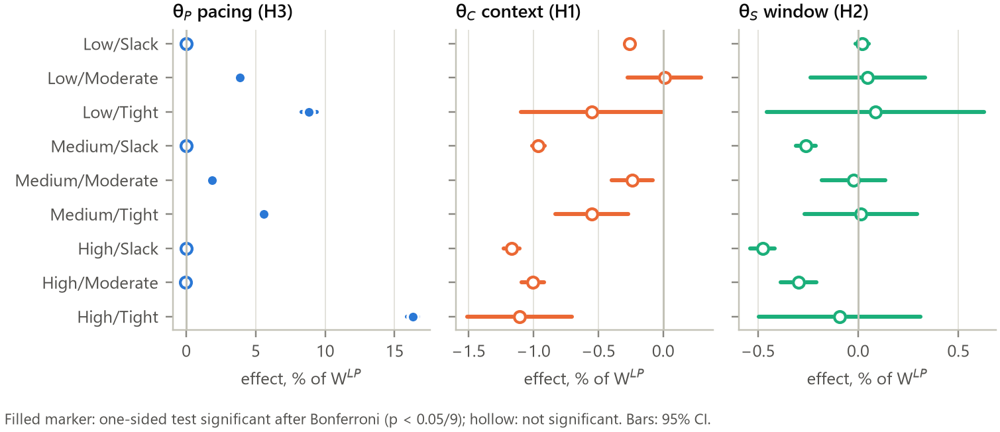
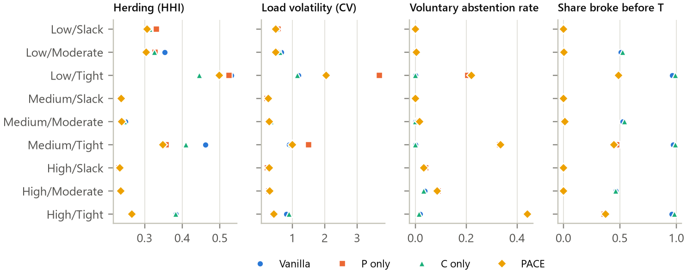
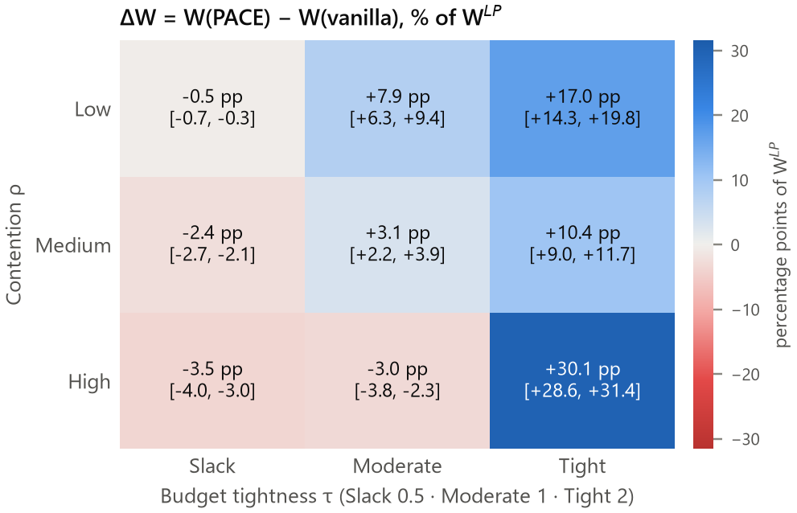
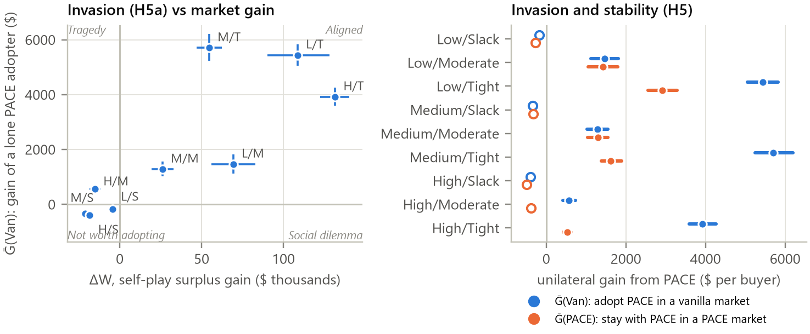
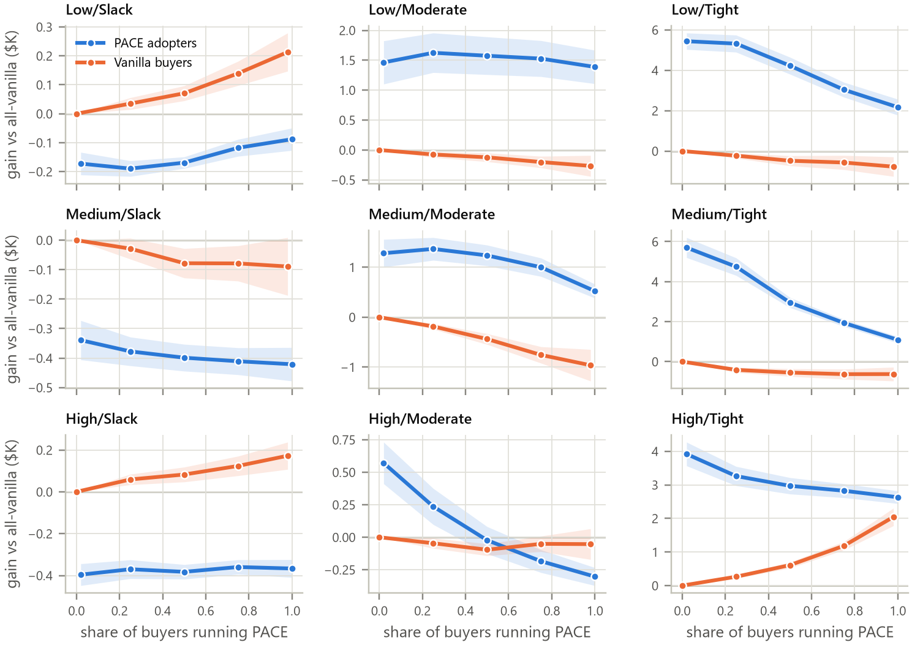
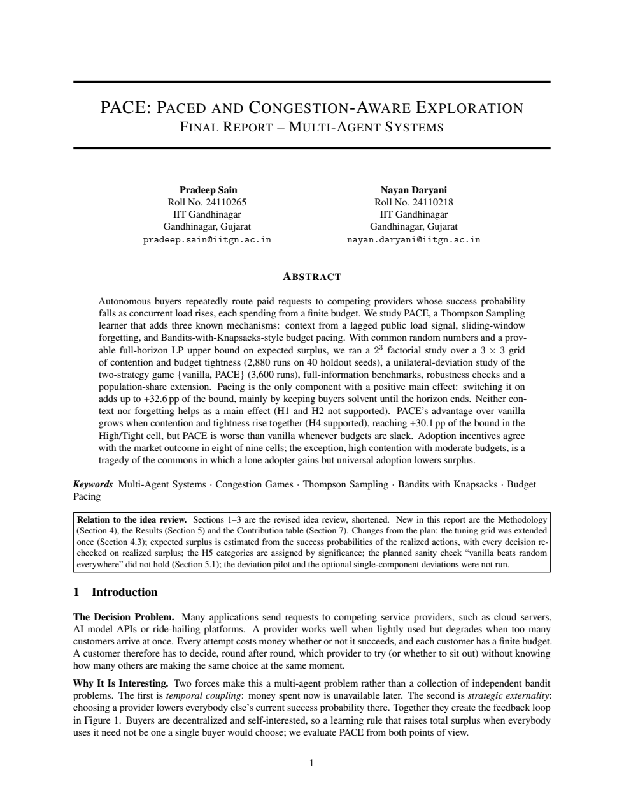
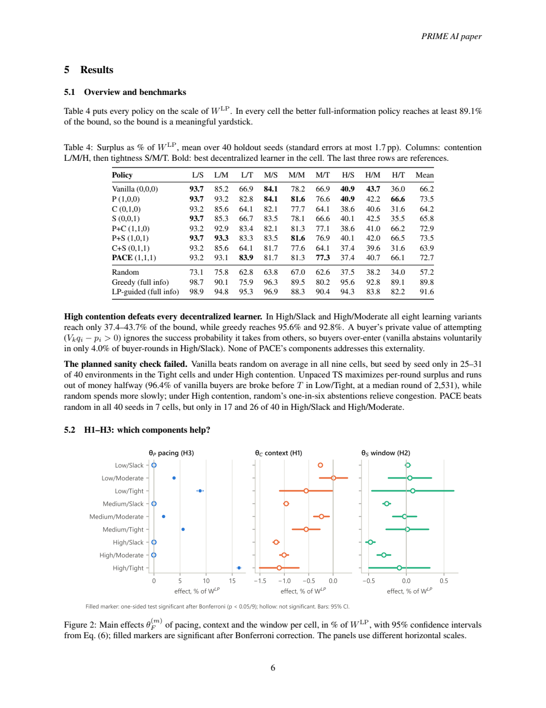

# PACE: Paced and Congestion-Aware Exploration

**Multi-Agent Systems course project — Group 41, IIT Gandhinagar**
Pradeep Sain (24110265) · Nayan Daryani (24110218)

PACE studies a market of **50 self-interested learning buyers** who repeatedly send paid requests to
**5 congestible providers**. Every attempt costs money from a finite budget, and a provider's
success probability drops as more buyers choose it in the same round. The buyers learn with
Thompson Sampling, and we ask which of three well-known add-ons actually help them, when, and
for whom:

- **P — budget pacing** (Bandits-with-Knapsacks style),
- **C — load context** (conditioning on the *lagged* public load, which the buyers themselves create),
- **S — sliding-window forgetting**.

The project combines a **2³ factorial study** (2,880 runs), a **unilateral-deviation study** of the
two-strategy game {vanilla, PACE} (3,600 runs), full-information benchmarks with a **provable LP upper
bound**, robustness checks and a population-share extension — **13,760 simulated markets** in total.



---

## Contents

1. [Headline results](#headline-results)
2. [The problem](#the-problem)
3. [Method: the PACE learner](#method-the-pace-learner)
4. [Experimental design](#experimental-design)
5. [Results in detail](#results-in-detail)
6. [Repository structure](#repository-structure)
7. [Reproducing everything](#reproducing-everything)
8. [Implementation checks](#implementation-checks)
9. [Limitations](#limitations)
10. [Contributions and use of AI tools](#contributions-and-use-of-ai-tools)
11. [References](#references)

---

## Headline results

| Hypothesis | Question | Verdict |
|---|---|---|
| **H1** context | Does conditioning on the lagged load help? | **Not supported.** Never significantly positive; significantly *negative* in 7 of 9 cells. |
| **H2** window | Does sliding-window forgetting help? | **Not supported.** Never significantly positive; tuning already chose the longest window. |
| **H3** pacing | Does budget pacing help? | **Supported** in 5 of the 6 cells where budgets bind (up to +32.6 pp of the LP bound when switched on). |
| **H4** interaction | Does PACE's advantage grow when contention *and* tightness rise together? | **Supported**: λ₃ = $9,205 (95% CI $4,749–$13,537), p < 10⁻⁴. |
| **H5** incentives | Would a self-interested buyer adopt PACE, and keep it? | **Supported in 5 cells, rejected in 4**: not worth adopting with slack budgets; a *tragedy of the commons* under high contention with moderate budgets. |

In one sentence: **pacing is what matters** — it keeps buyers solvent until the end of the horizon —
while context and forgetting do not help on their own; and the biggest inefficiency of all,
**over-entry under high contention**, is something no learning rule here can fix.

---

## The problem

A repeated stochastic game with K = 50 buyers, N = 5 providers and T = 5,000 rounds.

- Buyer *k* has a private value V_k ~ U(4, 10) per success and a budget B_k(0).
- Provider *i* has a maximum reliability q_i^max ~ U(0.5, 1), a capacity c_i and a fixed price
  p_i ∈ {$1.00, 1.50, 2.00, 2.50, 3.00} (more reliable providers are more expensive).
- Each round every buyer simultaneously picks a provider or abstains. If n_i buyers pick provider *i*,
  each succeeds with probability

  ```
  q_i = q_i^max · min(1, (c_i / n_i)^γ)        (γ = 1 in the main experiments)
  ```

- Every attempt is paid whether it succeeds or not. A buyer's surplus is U_k = Σ_t (V_k·X_k(t) − p_a).
- Buyers see only their own history, their budget and the **lagged** load n(t−1) — never the current one.

Two forces make this a genuine multi-agent problem: **temporal coupling** (money spent now is gone
later) and a **strategic externality** (choosing a provider lowers everyone else's success there).

The environment is a 3×3 grid:

| | Slack budgets (τ = 0.5) | Moderate (τ = 1) | Tight (τ = 2) |
|---|---|---|---|
| **Low contention** (ρ = 0.5) | L/S | L/M | L/T |
| **Medium** (ρ = 1) | M/S | M/M | M/T |
| **High** (ρ = 2) | H/S | H/M | H/T |

ρ = K / Σ c_i measures demand relative to capacity; τ = T·p̄ / mean budget measures how binding the
budget is. With slack budgets a buyer can never run out of money, so pacing is exactly inert there —
a built-in negative control.

---

## Method: the PACE learner

Every learner is the same Beta–Bernoulli Thompson Sampling core with three on/off switches
(P, C, S), so a factorial comparison isolates each mechanism. **Vanilla** is (0,0,0); **PACE** is (1,1,1).

One round for buyer *k*:

```
1. Observe the lagged load n(t-1); if C = 1 use bucket b_i = min(floor(n_i(t-1)/5), 9), else b_i = 0
2. If S = 1, forget the observation made L rounds ago (subtract it from its Beta posterior)
3. For every affordable provider i:  q~_i = inverse-Beta-CDF(alpha_{i,b_i}, beta_{i,b_i}; u_{t,k,i})
4. Choose a = argmax{ 0 (abstain);  V_k * q~_i - p_i * (1 + phi_k) }      (phi_k = 0 if P = 0)
5. Pay p_a, observe success X, update the posterior of the bucket seen at decision time
6. If P = 1:  phi_k <- max(0, phi_k + eta * (p_a - B_k / (T - t + 1)))     (pacing multiplier)
```

- **Informed prior** α = p_i, β = 4 − p_i: prices reveal the *ranking* of providers, so every learner
  starts from mean p_i/4 with only four pseudo-observations.
- **Pacing** inflates the perceived price when a buyer spends faster than its budget allows.
- **Exact Thompson samples** are drawn through the inverse Beta CDF from pre-drawn uniforms, so
  every comparison uses common random numbers.

### Baselines and the LP upper bound

| Policy | Information | Role |
|---|---|---|
| Vanilla TS (0,0,0) | own history | does PACE earn its complexity? |
| Random | none | uninformed floor |
| Centralized greedy | full | strong myopic reference |
| LP-guided | full | randomized plan from the LP below |
| **LP upper bound W^LP** | full | normalizer for every result |

The bound is a fluid relaxation solved once per environment (250 variables, 105 constraints,
median 3 ms with HiGHS):

```
W_LP = max_{z >= 0}  Σ_{k,i} (q_i^max V_k − p_i) z_{k,i}
       s.t.  Σ_k z_{k,i} <= c_i T,   Σ_i z_{k,i} <= T,   Σ_i p_i z_{k,i} <= B_k(0)
```

For γ ≥ 1 we prove that **no policy, centralized or decentralized, can beat it**: the expected
payoff of the actions actually taken is ≤ W^LP on every sample path (Proposition 1 in the report).
All 13,600 runs with γ = 1 respect it, and the full-information policies reach it exactly in a few
uncongested environments, so it is tight where it can be.

---

## Experimental design

| Study | Tests | Design | Runs |
|---|---|---|---|
| Tuning | — | η × L grid for PACE on 10 validation seeds | 4,320 |
| A. Components | H1–H3 | all 8 (P,C,S) variants, every cell, 40 holdout seeds | 2,880 |
| B. Environment | H4 | vanilla vs PACE of study A, pooled over cells | — |
| C. Incentives | H5 | one buyer deviates (invasion: PACE among vanilla; stability: vanilla among PACE), 5 value quantiles | 3,600 |
| D. Benchmarks | — | random, greedy, LP-guided + LP bound | 1,080 |
| E. Robustness | — | information delay, window, pacing step, γ, prior strength (2 corner cells) | 800 |
| F. Shares (ext.) | — | PACE adopted by 25 / 50 / 75 % of buyers | 1,080 |

- **Seeds**: 50 base environments; 0–9 only for tuning, 10–49 for every reported result. Each
  environment is rescaled into all nine cells.
- **Common random numbers**: success draws and Thompson samples come from arrays pre-drawn per seed,
  so changing one buyer's policy changes nobody's random numbers.
- **Tuning** picked η* = 1 (an interior optimum) and L* = 3,200 — the score rose with L in every row,
  an early sign that forgetting does not pay.
- **Statistics**: per-cell factorial ANOVA with a seed fixed effect (H1–H3, one-sided, Bonferroni over
  9 cells); a regression of ΔW on log₂ρ, log₂τ and their product with a 10,000-replication seed
  bootstrap (H4); seed-level bootstrap tests of the unilateral gains (H5).

---

## Results in detail

### 1. Every policy on the scale of the LP bound

Surplus as % of W^LP, mean over 40 holdout seeds (columns: contention L/M/H, then tightness S/M/T):

| Policy | L/S | L/M | L/T | M/S | M/M | M/T | H/S | H/M | H/T | Mean |
|---|---:|---:|---:|---:|---:|---:|---:|---:|---:|---:|
| Vanilla (0,0,0) | 93.7 | 85.2 | 66.9 | 84.1 | 78.2 | 66.9 | 40.9 | 43.7 | 36.0 | 66.2 |
| P (1,0,0) | 93.7 | 93.2 | 82.8 | 84.1 | 81.6 | 76.6 | 40.9 | 42.2 | 66.6 | 73.5 |
| C (0,1,0) | 93.2 | 85.6 | 64.1 | 82.1 | 77.7 | 64.1 | 38.6 | 40.6 | 31.6 | 64.2 |
| S (0,0,1) | 93.7 | 85.3 | 66.7 | 83.5 | 78.1 | 66.6 | 40.1 | 42.5 | 35.5 | 65.8 |
| P+C (1,1,0) | 93.2 | 92.9 | 83.4 | 82.1 | 81.3 | 77.1 | 38.6 | 41.0 | 66.2 | 72.9 |
| P+S (1,0,1) | 93.7 | 93.3 | 83.3 | 83.5 | 81.6 | 76.9 | 40.1 | 42.0 | 66.5 | 73.5 |
| C+S (0,1,1) | 93.2 | 85.6 | 64.1 | 81.7 | 77.6 | 64.1 | 37.4 | 39.6 | 31.6 | 63.9 |
| **PACE (1,1,1)** | 93.2 | 93.1 | 83.9 | 81.7 | 81.3 | 77.3 | 37.4 | 40.7 | 66.1 | 72.7 |
| Random | 73.1 | 75.8 | 62.8 | 63.8 | 67.0 | 62.6 | 37.5 | 38.2 | 34.0 | 57.2 |
| Greedy (full info) | 98.7 | 90.1 | 75.9 | 96.3 | 89.5 | 80.2 | 95.6 | 92.8 | 89.1 | 89.8 |
| LP-guided (full info) | 98.9 | 94.8 | 95.3 | 96.9 | 88.3 | 90.4 | 94.3 | 83.8 | 82.2 | 91.6 |

Two things stand out:

- **High contention defeats every decentralized learner.** In H/S and H/M all eight variants reach
  only 37–44 % of the bound while the greedy planner reaches 93–96 %. Attempting is privately
  profitable but congests everyone else, so buyers over-enter; none of PACE's components fixes that.
- **A planned sanity check failed.** Vanilla beats random on average everywhere, but not seed by seed
  under tight budgets or high contention: unpaced TS buys expensive attempts and goes broke halfway
  through, while random's abstentions accidentally relieve congestion.

### 2. Which components help? (H1–H3)


*Marginal main effects of pacing, context and the window per cell, in % of W^LP, with 95 % confidence
intervals. Filled markers are significant after Bonferroni correction. Note the different scales.*

- **Pacing** is significantly positive in every Moderate and Tight cell except High/Moderate, and
  exactly zero with slack budgets (the negative control). Switching it on adds +17.7, +11.2 and
  +32.6 pp of the bound in the three Tight cells.
- **Context** is never significantly positive and hurts most cells. Its harm depends on pacing: the
  pacing × context interaction is significantly positive in four cells, and with pacing on, context
  turns slightly positive in Low/Tight and Medium/Tight.
- **The window** is never significantly positive; like context, it helps a little only alongside
  pacing in Low/Tight and Medium/Tight — the only two cells where full PACE beats pacing alone.



*Why pacing works: without it, 96–97 % of buyers go broke before the end in the Tight cells (median
round ≈ 2,500); with it, 36–49 % do, and paced buyers buy cheaper attempts ($1.88 → $1.27 per attempt
in Low/Tight).*

### 3. Does PACE's advantage grow with contention and tightness together? (H4)

<p align="center"></p>

*Self-play gain of PACE over vanilla in percentage points of W^LP, with 95 % bootstrap intervals.*

Yes: λ₃ = $9,205 per unit of log₂ρ · log₂τ (95 % CI $4,749–$13,537), and it stays positive relative to
vanilla surplus (+16.5 %) and in points of the bound (+4.0 pp). The largest gain is **+30.1 pp in
High/Tight**. Two caveats: in this balanced 3×3 design λ₃ depends only on the four corner cells, and
the pattern is not monotone — PACE loses in every Slack cell and in High/Moderate.

### 4. Would a self-interested buyer adopt PACE? (H5)



| Cell | ΔW = PACE − vanilla (pp of W^LP) | Ḡ(Van): lone adopter's gain | Ḡ(PACE): gain from staying | Category |
|---|---:|---:|---:|---|
| Low/Slack | −0.5 | −$172 | −$275 | Not worth adopting |
| Low/Moderate | +7.9 | $1,463 | $1,425 | Aligned; stable |
| Low/Tight | +17.0 | $5,440 | $2,915 | Aligned; stable |
| Medium/Slack | −2.4 | −$339 | −$323 | Not worth adopting |
| Medium/Moderate | +3.1 | $1,280 | $1,294 | Aligned; stable |
| Medium/Tight | +10.4 | $5,703 | $1,618 | Aligned; stable |
| High/Slack | −3.5 | −$396 | −$493 | Not worth adopting |
| **High/Moderate** | **−3.0** | **$571** | **−$383** | **Tragedy** |
| High/Tight | +30.1 | $3,919 | $526 | Aligned; stable |

- Where budgets bind, PACE is good for the market **and** for the buyer who adopts it, and the
  all-PACE market is stable — the market gain is self-enforcing.
- Under tight budgets a lone adopter gains far more than a buyer in an all-PACE market (a "late
  market" effect: vanilla buyers go broke around round 2,500 and leave it a half-empty market).
- **High/Moderate is a tragedy of the commons**: a lone adopter gains, but universal adoption lowers
  surplus and is not stable.



*Extension: gains of adopters and holdouts as the share of PACE adopters grows (bands: 95 % intervals).
In High/Moderate the curves cross between 50 % and 75 % adoption, so self-interested buyers settle on
a mixed population that earns less than an all-vanilla market.*

### 5. Robustness

In both corner cells the sign of ΔW survives every one-at-a-time change (information delay d = 2, 5;
window L = 50, 800; pacing step η*/2, 2η*; congestion γ = 0.5, 2; prior strength 1, 20). A staler load
signal changes almost nothing — consistent with context carrying little usable information — and
shorter windows only make PACE worse.

### The report

The full write-up (11 pages, LaTeX, same template as our idea review) is built from `report/`:

| Title page | Results page |
|---|---|
|  |  |

---

## Repository structure

```
PACE/
├── README.md
├── requirements.txt
├── src/                    simulation and analysis code
│   ├── env.py              environment draws, per-cell rescaling, common random numbers, congestion rule
│   ├── agents.py           the Thompson Sampling core with per-buyer P / C / S switches (vectorized)
│   ├── baselines.py        random, centralized greedy, LP upper bound, LP-guided policy
│   ├── runner.py           experiment definitions; parallel, resumable execution
│   └── analysis.py         ANOVA, bootstrap regression, incentive analysis, all figures
├── tests/
│   └── test_checks.py      the implementation checks promised in the proposal
├── results/                raw output of every run (no re-simulation needed to re-analyse)
│   ├── runs.csv            one row per run: configuration, surplus, diagnostics, runtime
│   ├── buyers.csv          every buyer's surplus in every run
│   ├── lp.csv              the LP bound for every (seed, cell)
│   ├── summary.json        every statistic quoted in the report
│   ├── tuning_choice.json  the selected η and L
│   └── logs/               run logs and timings
├── figures/                all figures (PNG for viewing, SVG; PDFs are generated, not tracked)
├── report/                 LaTeX report
│   ├── main_template.tex   report text with @@placeholders@@ for every number
│   ├── main.tex            filled-in version (upload this + figures to Overleaf)
│   ├── PRIMEarxiv.sty      layout of the "PRIME AI paper" template
│   ├── report_values.py    computes the numbers quoted in the text from summary.json
│   └── build_tex.py        fills the template and compiles the PDF
└── docs/
    ├── proposal_idea_review.md   early version of the project proposal
    └── images/             report previews used in this README
```

PDFs are deliberately **not tracked** (see `.gitignore`); the report PDF is rebuilt from source.

---

## Reproducing everything

Requires Python 3.10+ (we used 3.14.6).

```bash
pip install -r requirements.txt

python tests/test_checks.py        # 8 implementation checks, about 1 minute
python src/runner.py lp            # LP bound for all 450 (seed, cell) pairs, a few seconds
python src/runner.py tune          # eta / L grid on validation seeds 0-9
python src/runner.py main          # all holdout studies (about 40 minutes on 15 cores)
python src/analysis.py             # statistics -> results/summary.json, figures -> figures/
python report/build_tex.py         # LaTeX report -> report/main.pdf
```

- `runner.py` runs on all CPU cores but one (set `PACE_WORKERS` to change this). It appends results
  batch by batch and skips finished runs, so it can be interrupted and restarted.
- Because `results/` is in the repository, you can skip the three `runner.py` steps and go straight
  to `analysis.py`.
- `build_tex.py` needs a LaTeX engine: it calls [Tectonic](https://tectonic-typesetting.github.io)
  (set `TECTONIC` to its path if it is not on `PATH`). To use Overleaf instead, run
  `python report/build_tex.py --no-compile` and upload `report/main.tex`, `report/PRIMEarxiv.sty`
  and `report/figures/`.
- The whole study took 13,760 runs and about 12.4 CPU-hours (≈ 50 minutes on a 16-thread laptop).

Expected test output:

```
PASS test_context_uses_lagged_load
PASS test_no_overspend
PASS test_no_run_beats_lp_bound
PASS test_switch_isolation_and_window
PASS test_same_prior_for_all_variants
PASS test_crn_batch_invariance
PASS test_negative_control_pacing_inert_when_slack
PASS test_learners_beat_random
```

---

## Implementation checks

Because the study is entirely simulation-based, correctness checks are part of the method:

| Check | What it guarantees |
|---|---|
| Lag correctness | the context is always the load of round t − d, never the current round |
| Budget safety | no buyer ever spends more than its budget (every learner and baseline) |
| LP bound | no run's expected surplus exceeds W^LP (also checked over all 13,600 γ = 1 runs) |
| Switch isolation | P = 0 keeps the pacing multiplier at 0; C = 0 uses one posterior; S = 0 never forgets |
| Window exactness | a windowed posterior equals the prior plus exactly the last L observations |
| Shared prior | all eight variants start from the same informed prior |
| Common random numbers | a run gives bit-identical results alone or inside any batch |
| Negative control | pacing changes nothing when budgets are slack |

---

## Limitations

- η and L were tuned for PACE and shared by every variant; short windows were tested only in two cells.
- Stability against unilateral deviation within {vanilla, PACE} is not a Nash equilibrium of the full
  game — a buyer might prefer pacing alone, and the single-component deviations were not run.
- The H4 regression assumes a log-linear effect that the data do not show; λ₃ summarizes the corners.
- N, K, T, the prices and the congestion family are fixed; mechanisms are read from diagnostics, not tested.
- Every hypothesis decision is unchanged when realized surplus replaces the expected-surplus estimator.

---

## Contributions and use of AI tools

| Task | Assigned to | Done |
|---|---|---|
| Problem formulation, model, learning and pacing rules (idea review) | Nayan Daryani | Yes |
| Literature review, hypotheses, experimental and statistical design (idea review) | Pradeep Sain | Yes |
| Simulator and automated checks | Nayan (lead) | Yes |
| Tuning of η and L | Pradeep (lead) | Yes |
| Pilot of the deviation study | Pradeep | No (not needed: intervals were narrow) |
| Main runs | Both | Yes |
| Analysis and figures | Pradeep (lead) | Yes |
| Robustness checks | Nayan | Yes |
| Optional extensions (population shares; single-component deviations) | Both | Yes; No |
| Final report | Both | Yes |

**Use of AI tools.** AI tools were used for limited editorial assistance, including
formatting the report and reviewing the cited literature references for consistency and
completeness. The research, implementation, experiments, analysis and conclusions were
carried out by the authors. We take responsibility for the content.

---

## References

1. W. R. Thompson (1933). On the likelihood that one unknown probability exceeds another in view of the evidence of two samples. *Biometrika* 25(3/4).
2. D. Russo, B. Van Roy, A. Kazerouni, I. Osband, Z. Wen (2018). A tutorial on Thompson sampling. *Foundations and Trends in Machine Learning* 11(1).
3. A. Badanidiyuru, R. Kleinberg, A. Slivkins (2013). Bandits with knapsacks. *FOCS*.
4. S. Agrawal, N. R. Devanur, L. Li (2016). An efficient algorithm for contextual bandits with knapsacks. *COLT*.
5. R. W. Rosenthal (1973). A class of games possessing pure-strategy Nash equilibria. *International Journal of Game Theory* 2(1).
6. T. Roughgarden, É. Tardos (2002). How bad is selfish routing? *Journal of the ACM* 49(2).
7. R. Kleinberg, G. Piliouras, É. Tardos (2009). Multiplicative updates outperform generic no-regret learning in congestion games. *STOC*.
8. J. Rosenski, O. Shamir, L. Szlak (2016). Multi-player bandits — a musical chairs approach. *ICML*.
9. E. Boursier, V. Perchet (2019). SIC-MMAB: Synchronisation involves communication in multiplayer multi-armed bandits. *NeurIPS*.
10. S. R. Balseiro, Y. Gur (2019). Learning in repeated auctions with budgets. *Management Science* 65(9).
11. A. Garivier, E. Moulines (2011). On upper-confidence bound policies for switching bandit problems. *ALT*.
12. M. P. Wellman (2006). Methods for empirical game-theoretic analysis. *AAAI*.
13. W. B. Arthur (1994). Inductive reasoning and bounded rationality. *American Economic Review* 84(2).
